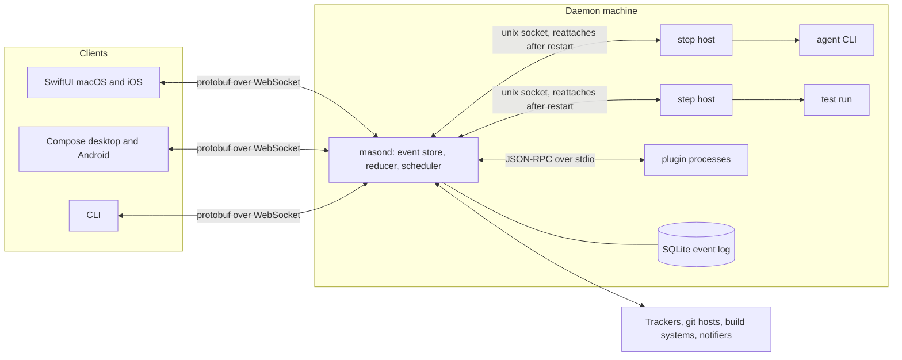
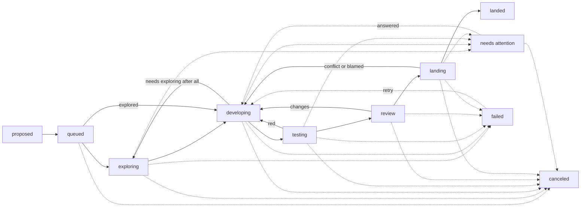

# MASON design

This is the approved design for MASON (Multi-agent Automation and Session Orchestration Network). The owner reviewed it part by part and approved all 24 parts, including the changes marked "Changed from your review". `MASON_MIGRATION_PLAN.md` says how to build it and move projects onto it, in stages.

Where this text says "you", it means the owner. "I" is the design's author.

# MASON: a pipeline that lives outside the projects it builds

**Multi-agent Automation and Session Orchestration Network.** A from-scratch design for an automated development pipeline in its own public GPLv3 repository, with a Rust backend, serving any number of projects at once, configurable from a graphical monitor, and able to maintain itself.

### Already decided by you

| Question | Your answer | Where it shapes the design |
| --- | --- | --- |
| Topology | One owner, one daemon, remote workers later | Parts 2, 7 |
| LLM execution | Wrap coding-agent CLIs, tools over MCP | Part 6 |
| Clients | SwiftUI and Compose together, kept in parity | Parts 16, 17, 18, 20 |
| Proof | Itself, then a new project, then the desktop-focused repo and three more personal projects. The mobile repo is a reference only. | Part 24 |
| Queue position | Furthest along wins, then tracker priority, then enqueue time | Part 7 |
| Self-change | Lands freely, except changes that weaken its own gates | Part 13 |
| Config home | Client repo plus a local overlay | Part 5 |
| Distribution | Public, GPL-3.0-or-later with an App Store permission, DCO sign-off, outside contributions by GitHub PR | Parts 20, 22 |
| Name | MASON: Multi-agent Automation and Session Orchestration Network | Throughout |
| Release pipelines | Left out | Part 24 |

### What the earlier pipelines measured

I read both code bases and queried about 1,000 recorded LLM sessions. These numbers drive more of the design than any other input.

**19%** of LLM sessions (187 of 993) were cut off by the pipeline restarting itself. Part 2 makes restarts harmless.

**24%** of development session time (56 of 237 hours) went to waiting on a machine lock. Part 6 stops a waiting task from occupying a session.

**24%** of landed tasks (37 of 152) were pushed past verification by hand, 77 times. Skipping is a main workflow, so Parts 8 to 10 design for it.

**6%** of sessions ended with no result. In the 43 examined, about 30 traced to a tool timeout that left the agent waiting for an absent human.

**1,581** failures logged by one poll that could never succeed. A permanent error also held one task for 25 hours. Parts 3 and 14 catch both.

**~120** behaviour gaps found when one project's two clients were audited against each other. Part 17 enforces parity by machine.

Size is a warning too. One earlier pipeline grew to a 6,577-line configuration file, about 175 scripts and 691 regression scripts, because each lesson became another switch. Parts 1 and 23 are written to keep this one from going the same way.

---

# A. Foundations

## Part 1: Principles

Nine rules that every other part follows and that code review, including LLM review, can check against.

*Size: S | Depends on: nothing | If discarded: the rest needs a replacement set of rules*

| Rule | What it means in practice |
| --- | --- |
| **Code moves tasks; models work inside steps** | Sequencing, retries, leases and landing are deterministic code. An LLM runs only inside a step and finishes by calling a validated tool. |
| **Proof beats claims** | A test passed only if its output proves tests executed. An exit code alone never counts, and zero tests run is a failure. |
| **Waiting is never failure** | Every wait is named, shown, excluded from all timeouts and doesn't occupy an LLM session. |
| **Overrides are easy and recorded** | Skipping takes one click and always leaves a visible debt. |
| **Events, no cycles** | Everything inside the system reacts to a change. Polling exists only at the edge, for outside services that can't call back. |
| **Clients are disposable** | Closing every monitor changes nothing. Clients change state only through the API. |
| **Alerts must be true** | An alert is tied to a live condition and clears when the condition clears. Nothing nags about a resolved problem. |
| **Switches expire** | Temporary overrides carry an owner and an expiry. A new setting needs a reason a typed default can't cover. |
| **Outside text is data** | Issue text, comments, logs and PR bodies from anyone but the owner are fenced as untrusted, never instructions. |

## Part 2: Repository, stack and process model

One public monorepo. One daemon per machine. One small detached host process per running step, so the daemon can restart without disturbing any work in flight.

*Size: L | Depends on: 1 | If discarded: everything needs a new home; this is the skeleton*



### The step host is the key decision

Each running step, whether an agent session, a test run or a build, gets its own small `step-host` process in its own session. It owns the child process, journals output to a file, and talks to the daemon over a unix socket. If the daemon restarts, step hosts keep running and buffer what they have. The new daemon finds them in a registry and reattaches. This removes the failure that cost 19% of earlier sessions.

### Stack

- **Rust** with `tokio`, `axum` for HTTP and WebSocket, `rusqlite` in WAL mode behind a single writer thread, `prost`, `notify`, `mdns-sd`, `toml_edit`, `tracing`.
- **Blocking work never runs on the event loop.** Git, network and process calls go through bounded worker pools. A watchdog alerts if the loop stalls, because an earlier pipeline froze entirely when one network call ran there.
- **The daemon targets macOS and Linux** (launchd and systemd). Windows is limited to clients for now.

### Repository layout

```text
crates/
  core/          domain types and the pure state machine (no IO)
  engine/        reducer, effects, scheduler
  store/         event log, projections, migrations
  protocol/      generated from schemas/
  adapter-api/   traits and the plugin wire protocol
  adapters/      local-tracker, github, jenkins, generic-ci, claude-code, codex, fake-agent, ...
  step-host/     detached per-step supervisor
  testing/       parsers, verdicts, evidence ledger
  landing/       batches, integration branches, promotion
  daemon/  cli/  binaries
clients/
  swift/         MonitorCore package, macOS and iOS apps
  compose/       shared core, desktop and Android apps
  conformance/   scripted scenarios both clients must pass
schemas/         mason.proto, definition JSON Schema
templates/       starter workflows and test packs
prompts/         default prompt packs
```

### Sharing across projects

| Isolated per project | Shared across the machine |
| --- | --- |
| Definition, worktrees, tracker and host credentials, logs, evidence, landing queue, prompts, extensions | LLM session pools per provider account, machine resources and devices, notifications, monitor connections, the event store |

Every lease and step run records a `host`, which is always `local` in the first release. Remote workers can arrive later without a schema change, as you chose.

## Part 3: Event-driven core

Every change is an event in an append-only log. A pure reducer decides what happens next, and subscribers hear about it at once. Nothing waits for a cycle.

*Size: M | Depends on: 2 | If discarded: you lose the responsiveness requirement and resumable monitors*

```text
(state, event) -> (state', effects)      pure, no IO, no clock access
effects run on workers and report back as new events
each event gets a sequence number; clients resume from their last one
```

### Targets

- A step ends and the next is admitted within 100 ms, excluding the git work it then does.
- A state change reaches a connected monitor within 250 ms on the local network.
- A resource frees and the next waiter starts immediately, in rank order.
- A monitor reconnecting after sleep receives only what it missed.

### Outside services, stated plainly

A desktop behind a home router can't receive webhooks directly, so external signals can't all be push. Each adapter declares what it supports, and the engine uses the best available:

| Mode | How it works | Used when |
| --- | --- | --- |
| Push | Webhook, directly or through a relay such as `gh webhook forward` | The owner configures a route in |
| Conditional poll | ETag requests, and only for items something is actually waiting on, with backoff. Unchanged responses don't count against GitHub's primary rate limit. | Default for trackers and CI |
| Monitor pull | Refresh on demand when you open a task | Always available |

Polling errors are classified. A permanent error (a 404, or a 422 that won't change) stops the poll and raises attention at once, rather than retrying for 25 hours.

### A safety sweep that reports on itself

A slow reconcile pass runs every few minutes and compares projections with reality. If it ever finds something the event path missed, it fixes it and files a bug. It's a detector, so nothing relies on it for normal progress.

## Part 4: Task model and lifecycle

Your ten states become fixed categories that every step belongs to, so counts and colours mean the same thing in every project, however the graph is arranged.

*Size: M | Depends on: 3 | If discarded: Parts 5 and 17 need another way to group steps*



> **Two additions to your list.** A task needs a successful end, so I added `landed`, with an outcome of either *merged* or *closed with no change* (already fixed, duplicate). I also added an **activity** field alongside the state, below.

### State and activity are separate

State says where a task is in the graph. Activity says what it's doing right now: `running`, `waiting(on: build slot, 2nd in line)`, `held(blocked by #41)`, `paused`. Earlier designs packed both into one word, which produced monitors reporting "needs you" for a task that was busy landing. Exactly one state and one activity are true at any time, and they change in one transaction.

### Entities

**Project**, **Task** (external reference, priority, blockers, enqueue time, trust source), **StepRun** (step, attempt, runner, budgets, outcome), **Wait**, **Decision** (a question for you), **Verdict**, **Batch**, **Proposal**, **Alert**, **Override**, **Debt**.

### Behaviours carried over because they earned their place

- Tasks depend on other tasks, and a held task starts itself when its blockers land.
- A task can carry a not-before time.
- Retry can target any step. It first brings the branch up to date with the base, because a stale retry caused repeat failures before.
- Cancel works from any non-terminal state: it stops the step host, releases leases and keeps the branch unless you say otherwise.

### Skipping exploration when it's already done

> **Changed from your review.** Many tasks are written by models that have already read the code. A task can now go straight from `queued` to `developing` by either route below.

- **The `explored` flag.** Whoever files the task declares that exploration has been done. The flag means the task's body is the plan.
- **The clarity check.** For a task with no flag, a deterministic check looks for named files that exist on the base branch, stated acceptance criteria and a described approach. If everything passes, exploring is skipped. It needs no LLM, and a project can opt in to a cheap model for tasks the rules can't call. Anything uncertain gets explored.

The flag is advertised wherever a model filing work will look:

| Where | How it appears |
| --- | --- |
| CLI | `mason task add --explored`, documented in `mason help filing` |
| Agents inside MASON | An `explored` argument on `file_proposal`, described in the tool's schema |
| Task text | `explored: true` front matter in a local or GitHub issue body, or a `mason:explored` label |
| The project's agent notes | `mason init` adds a short "Filing work" section to `AGENTS.md` or `CLAUDE.md` explaining the flag and when to use it |

Rules that keep it honest:

- **Outside text can't claim it.** The flag counts only on tasks filed by the owner or the owner's agents. On anything else it's ignored until the owner approves the task, and then the owner's approval decides.
- **The definition chooses the entry step.** `explored_entry = "develop"` names where these tasks start. A project that leaves it out always explores, and the validator checks the step exists.
- **You can always see and undo it.** Task detail says why exploring was skipped and offers "Explore anyway".
- **The developing agent has a way back.** If the task doesn't hold up against the code, `request_exploration` sends it to `exploring` with a reason, and no failure is charged.
- **The digest checks the result.** It reports how many tasks skipped by each route and how many came back, so a check that's too eager shows up in the numbers.

## Part 5: Pipeline definitions and configuration

A typed, versioned graph in the client repo, safe for both people and the GUI to edit, with machine facts and secrets kept in a local overlay.

*Size: L | Depends on: 4 | If discarded: Parts 8, 9, 12 and 18 lose their format*

```text
# .mason/mason.toml
schema = 1
start  = "explore"
explored_entry = "develop"   # where explored tasks start (Part 4)

[step.explore]
type = "agent"; category = "exploring"; agent = "fast"; next = "develop"

[step.develop]
type = "agent"; category = "developing"; agent = "deep"; budget = "4h"
next = "test-fast"; tools = ["run_check", "ask", "file_proposal"]

[step.test-fast]
type = "test"; category = "testing"; suites = ["lint", "unit"]
next = "test-device"; on_red = "develop"; max_rounds = 2

[step.test-device]
type = "test"; category = "testing"; suites = ["device-smoke"]
when = "plan.needs_device"; uses = { phone = 1 }
next = "review"; on_red = "develop"

[step.review]
type = "agent"; category = "review"; read_only = true; next = "land"

[step.land]
type = "landing"; category = "landing"; policy = "landing.toml"
```

### Built-in step types

`agent`, `command`, `test`, `gate` (a check over recorded evidence), `approval` (waits for you), `ci`, `pr`, `landing`, plus any type a plugin adds (Part 12).

### Graph rules, checked on every save

- Every path reaches a terminal state, and every loop has a bound.
- Fan-out runs steps in parallel; a join decides on all-green or first-red.
- Every referenced resource, suite, agent, plugin and entry step exists.
- A dry run walks scripted tasks through the graph with no LLM or network, so you can see what a change does before applying it.

### Layering, lowest to highest

1. Built-in defaults from the running version
2. The project's `.mason/`, read from the base branch
3. The local overlay in `~/.config/mason/projects/<id>.toml`: machine facts, slot counts, secret references
4. Runtime overrides from the monitor, each with an owner and expiry
5. Per-task overrides, such as a model choice or a skip

### Key decisions

- **TOML, written with `toml_edit`,** so GUI edits preserve your comments and ordering and produce small diffs.
- **The definition comes from the base branch,** so a task can't relax the gates it's being judged by. A task that edits `.mason/` is validated against the new definition, which only takes effect after landing.
- **GUI edits apply immediately,** and the daemon commits them to the base branch (or opens a PR, if the project requires one).
- **Each task stays pinned to the definition it started under.** Before you apply an edit, the monitor shows what it affects: "2 tasks in this step will finish on the old version."

---

# B. Running work

## Part 6: Agent runner and step contract

Coding-agent CLIs run behind one interface. Each step has validated tools for finishing, and a session can suspend during long waits so it holds no slot at all.

*Size: L | Depends on: 2, 4 | If discarded: no LLM work can run; this part is required*

### One normalized event stream

```text
trait AgentAdapter {
  fn capabilities(&self) -> AgentCaps;  // resume, mcp, effort levels, usage reports
  fn start(&self, spec: SessionSpec) -> SessionHandle;
  fn resume(&self, id: SessionId, note: String) -> SessionHandle;
}
enum AgentEvent { Text, ToolCall, Tokens, RateLimit, ApiRetry, Finished(Outcome) }
enum Outcome { Accepted, NoResult, Timeout, UsageLimit, ProviderDown, Crash }
```

The first release ships **Claude Code** and **Codex CLI**, because a second adapter is the only real proof the interface is neutral. A **scripted fake agent** runs all tests.

### A step ends by passing validation

Pipeline tools reach the agent over MCP through its step host: `submit_plan`, `submit_change`, `submit_review`, `ask`, `file_proposal`, `run_check`, `report_progress`, `request_exploration`. A submit tool validates the work and replies either "accepted" or precisely what's wrong, and the agent fixes it in the same session. If the agent's turn ends with no accepted submission, it's nudged a set number of times before the step fails.

### Suspend during long checks

When an agent calls `run_check` for something long, the step host ends the turn cleanly and frees the LLM slot. The check runs under the scheduler, and the session resumes with the result. No process, slot or tool timeout is in play during the wait. Short checks run inline.

> **Needs a spike.** Suspending depends on each CLI resuming cleanly from a pending tool result. Prompt caches may also expire during long waits, which raises cost. Milestone 0 measures both. The fallback is a held session that doesn't count toward the slot limit, which is what exists today.

### What the runner controls so agents don't trip

- A sanitized environment, explicit tool timeouts, and a prompt preamble saying no human is watching and that "stop and wait" messages aren't from a person.
- Agents never fetch or push. The daemon does all remote git work and keeps the base ref current, because credentials in worktrees caused repeated stuck tasks.
- Read-only steps get a read-only tool set. Optional OS sandboxing (`sandbox-exec`, `bubblewrap`) limits writes to the worktree.
- A resumed session is told what happened and to verify the tree, since a resume that replayed the original prompt produced "already done" dead ends.

### Models, tokens and outages

- Named agent profiles (`fast`, `deep`) map to provider, model and effort per project, with a retry ladder that can move up a model.
- Tokens are attributed per session, step, task, project and provider. Live figures show only what the stream reports honestly. If a provider gives only a status and a reset time, the monitor shows that and doesn't invent a percentage.
- A usage limit or outage is a provider-wide *hold*, never a failure: affected tasks wait with no time charged, you're told once, and they resume at the reset. Falling back to another provider is opt-in.

## Part 7: Scheduler and shared resources

One ordering rule for every contended resource, across every project, and always able to explain itself.

*Size: M | Depends on: 3, 5 | If discarded: the priority requirement and multi-project sharing are unmet*

```text
rank = (interactive caller first,
        fewest steps remaining to landed,
        tracker priority,
        earliest enqueue time,
        task id)
```

Steps remaining is the shortest graph path from the current step to `landed`, ignoring loops, which makes tasks comparable across projects with different graphs. A project can opt in to letting top-priority tasks jump the progress rule. It's off by default, matching your answer.

### Resources

| Kind | Examples | Released by |
| --- | --- | --- |
| LLM sessions | Per provider account, adjustable live from any monitor | Turn end or suspend |
| Machine classes | `compile` (several), `test-suite` (one), `exclusive` (whole machine). Projects name their own. | Kernel-held file lock, so a dead holder frees it automatically |
| Named pools | Simulators, emulators, phones by capability, staging environments, display | Lease with step-host heartbeat |
| Landing | Batch slots, promote lock | Phase completion |

### Rules

- A step declares everything it needs, and the set is acquired at once, which rules out deadlock from holding one resource while waiting for another.
- A job may pass a waiter only by using resources that waiter doesn't need. A compile can pass a waiting test suite, and nothing passes a waiting exclusive job.
- The system counts jobs and never gates on load average. An optional free-memory floor applies when starting beside other work.
- A task isn't claimed until an LLM slot is available, so a full pool doesn't produce worktrees with nothing happening in them.
- Lowering the session limit never kills anything. It stops new admissions until the count falls.
- `mason run --needs compile -- <cmd>` and an optional agent hook let your interactive sessions take the same queue, ahead of pipeline work.

### Every wait explains itself

"Waiting for compile slot: 2nd in line, behind #88 (2 steps from landing), held by #91 for 4 min." You should never need to wonder why something isn't moving.

## Part 8: Testing system

Five concepts that adapt to a backend API, desktop GUI, mobile client or anything else, with verdicts proven from output.

*Size: XL | Depends on: 5, 7 | If discarded: test steps would be bare commands with exit-code verdicts*

| Concept | What it is |
| --- | --- |
| **Suite** | A command, a result parser, a minimum test count, resources, artifacts and a progress source. |
| **Environment** | What a suite runs against, with lease, setup, health check and teardown: local, simulator, emulator, physical device, service stack, staging URL or CI job. |
| **Level** | A named tier, such as `fast`, `unit`, `integration`, `e2e`, `device`, `soak`. Projects define their own. |
| **Binding** | When a level runs: in development, in a test step, per batch, after landing or on a schedule. This grid is what the monitor edits (Part 18). |
| **Impact map** | Path globs to suites. An unmapped path runs everything, so the safe outcome is the default. |

### The same concepts across project types

| Project | Typical suites and environments |
| --- | --- |
| Backend API | Unit, then a Docker Compose service stack for integration and contract tests, then a staging smoke test |
| Desktop GUI | Unit, then XCUITest or Compose UI tests on an `exclusive` display resource, then cross-OS CI jobs |
| Mobile | Unit, then leased simulators and emulators, then physical devices, including a wait for a person to plug one in |
| Library or CLI | Lint and unit, then a platform matrix through a CI adapter |

### Verdicts

- Built-in parsers: JUnit XML, TAP, xctest, Swift Testing, cargo-nextest, pytest, Gradle, Playwright, Cucumber JSON, and a regex fallback. Plugins can add more.
- **Green requires proof:** executed count at or above the minimum, and at least one. A vacuous pass is red.
- Red is classified before anyone is blamed:
  - **Flaky:** passed on an immediate rerun of the failing tests. Logged, and counts toward quarantine.
  - **Environmental:** matches a signature such as no device or an expired certificate. Becomes a wait plus an alert, charged to no task.
  - **Baseline:** also fails at the merge base. Excused, cached per base commit, and a fix is proposed.
  - **Product:** sent back to development.
- Closing verdicts rank worst-first: `unproven`, `unverified`, `untested`, `verified`. Each ticket's closing note states which applies and why.

### Optional gates from a library

- **Negative control:** run new tests against the old code and require them to fail.
- **Assertion-weakening scan:** a change that removes or loosens assertions must explain itself.
- **Acceptance table:** each criterion in the plan needs evidence.
- **Quarantine:** always with an owner and expiry.

### Evidence and skipping

Results are stored per tree hash and suite, so identical code never tests twice and restarts lose nothing. Any suite, step or batch gate can be force-skipped at any time, including one already running: green lanes keep their results, the verdict downgrades, and a **debt** is recorded. Debts can schedule a deferred run after landing, and they stay visible until paid.

## Part 9: Landing

Seven landing modes, configurable batching, different tests at each level, automatic culprit-finding and a crash-safe promote.

*Size: XL | Depends on: 7, 8, 11 | If discarded: tasks stop at a tested branch and you merge by hand*

```text
# .mason/landing.toml
mode     = "pr-batch"   # direct | direct-ci | local-only | local-only-ci | pr-each | pr-batch | host-queue
base     = "develop"
window   = "20m"        # collect from the oldest ready task
max_size = 0            # 0 means no cap
parallel = 2            # extra batches only if files and suites don't overlap

[[tier]]  name = "task";      suites = ["lint", "unit"]
[[tier]]  name = "batch";     suites = ["integration"]; ci = "github-actions"
[[tier]]  name = "post-land"; suites = ["smoke"];       on_red = "freeze"

[on_red]
ladder = ["rerun-failed", "blame-by-impact", "bisect", "ask"]
```

| Mode | Behaviour |
| --- | --- |
| `direct` | Integration branch, verify locally, fast-forward and push. No PR, no CI. |
| `direct-ci` | Integration branch, verify locally, push it to a temporary candidate ref, run CI there, and on green fast-forward the base and push. No PR. |
| `local-only` | The same as `direct`, stopping at the local base branch. You push. |
| `local-only-ci` | The same as `direct-ci`, stopping at the local base branch. Only the candidate ref leaves the machine, and you push the base. |
| `pr-each` | One PR and one CI run per task. Merges after CI and any required approvals. |
| `pr-batch` | One integration PR and CI run for a whole batch. |
| `host-queue` | Hands off to the git host's own merge queue. |

### CI without a PR

> **Changed from your review.** `direct-ci` and `local-only-ci` get CI's verification with no PR.

- **Candidate refs** are named `mason/ci/<batch>`. They are unique to a batch, never force-pushed, and deleted after promotion or ejection. The base branch is never the thing being tested.
- **The CI system has to run on an arbitrary ref.** GitHub Actions needs a workflow triggered by `mason/ci/**` or by `workflow_dispatch`, and `mason init` and `mason doctor` check for that and offer to add it. Jenkins and the generic adapter take the ref as a parameter.
- **`local-only-ci` still needs a remote** that CI can see, because that's how the code reaches CI.
- **They batch and recover like every other mode.** A CI red goes to the same ladder, and if the base moved before promotion, the new tip is folded in and CI runs again, up to the limit.
- **The validator keeps the modes distinct.** `direct` and `local-only` refuse a tier that names `ci`, and the error points to the CI version of the mode.

### The sequence

1. A task finishes its pre-landing tier, frees its slots and leases, and joins the queue.
2. A batch forms under the window, size and trigger rules, ordered by rank.
3. Branches merge into a disposable integration branch, in a persistent worktree so builds stay incremental. A conflict goes to a resolving agent, and if that fails the task is ejected without harming the others.
4. The batch's configured suites run once over the union diff, selected by the impact map.
5. On red, the ladder runs: rerun failures, blame by impact where the evidence is clear, bisect by halves, then ask you. Only blamed tasks are parked.
6. Promotion happens under a lock. If the base moved, it folds in the new tip and re-verifies, up to a limit.
7. Every phase is in the event log and merges are idempotent, so a crash at any point resumes without losing or double-landing anything.
8. Post-land tests run on the base. A red result can **freeze** landing, except for fixes, and automatically files a top-priority fix task.

### Parallel batches matter

An earlier design ran one batch at a time and left ready tasks waiting 56 hours while the queue was idle two-thirds of the time. Non-overlapping batches now run side by side, and the digest reports queue idle time.

### Fast lane and force

"Land this now" runs a task as its own batch with a chosen tier set. "Force" lands past whatever is still running. Both are one click, available at any stage, and leave a debt. Because a quarter of past landings used a bypass, the digest also reports *why*, so slow gates get fixed rather than routinely skipped.

## Part 10: Human attention and overrides

When a task needs you, you get a short decision card with choices. Most questions never reach you, and every override works from any client.

*Size: M | Depends on: 6 | If discarded: questions become free-text comments, and the measured failure below returns*

### The decision card

In past records the median question ran 3,440 characters with the decisive line about 1/42 of that, and 35% of all question text was pasted logs. The `ask` tool now rejects anything that doesn't fit this shape:

```text
Ask:     one sentence, at most 200 characters
Why you: why the ticket, repo and notes can't settle it
Options: 2 to 4 complete answers, exactly one recommended
         (the monitor always adds "Other" with a text box)
Evidence: at most 10 lines, plus links to stored logs
```

- A failing card goes through a cheap rewrite. If that fails too, a deterministic fallback is used, so no question is ever lost.
- Answers are tied to a hash of the question, so a late tap on a stale card is refused.
- If the same gate fails after your answer, it's recorded as acknowledged rather than asked again, so there are no loops.
- You can answer from any monitor, the CLI or a tracker comment. Only the owner's identity counts as an answer.

### Triage before it reaches you

An optional cheap agent sees each question first, with the repo and history. It may answer with cited evidence, close the question or escalate it. A sample of its answers is queued for your review, so you can see if its judgment drifts.

### Overrides

| Action | Effect | Recorded as |
| --- | --- | --- |
| Cancel | Stops work and releases everything. The branch is kept unless you choose otherwise. | Override |
| Skip test | Any suite, step or landing gate, even mid-run | Override and debt |
| Land now / force | See Part 9 | Override and debt |
| Retry from step | Catches up with the base, then re-enters | Override |
| Pause | All work, new claims only, or landing only; per project or global | Runtime override |
| Open session | Opens an interactive agent in the task's worktree, resuming its session if the step is idle | Override |

Giving a reason is optional, because a required reason adds friction exactly when you're in a hurry. Every override counts toward the "interventions per landed task" metric, the main measure of how much the pipeline needs you.

---

# C. Integrations

## Part 11: Adapters and plugin protocol

Every outside system sits behind a small trait with declared capabilities and a conformance kit. Adapters can be compiled in or run as separate processes.

*Size: L | Depends on: 2 | If discarded: the pipeline is tied to whichever services the core calls directly*

| Trait | First release | Later, or by plugin |
| --- | --- | --- |
| Issue tracker | Local (no service needed), GitHub Issues | Asana, Jira, Linear, GitLab Issues |
| Git host | Plain git (any remote), GitHub | GitLab, Bitbucket, Gitea |
| Build system | Local, GitHub Actions, Jenkins, generic command or URL | GitLab CI, Buildkite, CircleCI |
| LLM agent | Claude Code, Codex CLI, scripted fake | Gemini CLI, others |
| Notifier | Monitors, email (SMTP), ntfy, generic webhook | Slack, Discord |
| Test parser, environment, device provider, step type | Those listed in Parts 5 and 8 | Anything |

> **Changed from your review.** GitHub Issues is the only tracker service in the first release. The local tracker isn't a service. It stays because self-proposals (Part 13), the wizard's no-account default (Part 21) and the walking skeleton (Part 24) all rely on it.

### "Any git repository" and "any build system"

All core work uses the plain `git` CLI, so any remote works over SSH or HTTPS, including a bare repo on your own server. PRs, labels and checks are optional capabilities of a git host adapter, and if they're missing the project uses a mode that doesn't need them. For build systems, the generic adapter takes a trigger command or URL and a status command or URL, so a new system often needs no code at all. This covers git only, so Mercurial and Subversion are out of scope.

### Rules for adapters

- **Capabilities are declared,** and the wizard, monitor and validator only offer what's available.
- **Conformance kits:** each trait has a test suite that any implementation, built-in or external, must pass against a recorded or fake service.
- **Authority is split.** The tracker owns title, body, priority and closure. The pipeline's database owns state. Mirroring out is best-effort and never blocks work.
- **Credentials are references** to the OS keychain or a protected file, never values in config. Clients never see them.

### The plugin protocol

External adapters run as child processes speaking versioned JSON-RPC over stdio, with a manifest listing what they provide. Any language works. This boundary also keeps a private plugin clearly separate from the GPL core.

## Part 12: Project extensions

A project can add what only it needs, from a one-line prompt tweak to a new step type with its own editor form, without forking the pipeline.

*Size: M | Depends on: 5, 11 | If discarded: project-specific needs mean forking or waiting for upstream*

| Level | What you write | Good for |
| --- | --- | --- |
| 1. Customize | `extends = "develop"` with changes: appended prompt, different model, extra gate | A slightly different version of an existing step |
| 2. Script step | `type = "command"` in any language, with environment inputs and a JSON result file | A check, a generator, a deploy |
| 3. Process plugin | A folder in `.mason/extensions/` with a manifest | A new step type, parser, environment or adapter |
| 4. Prompt pack | Files in `.mason/prompts/` overriding defaults | Project conventions |

```text
# .mason/extensions/data-migration-check/manifest.toml
name = "data-migration-check"
provides = ["step-type:migration-check"]
run = "./check.py"
config_schema = "schema.json"   # the GUI builds its edit form from this
```

### Trust

Extension code runs with the pipeline's authority. Each extension is approved by content hash on first use and again when it changes. Extensions from a task branch or an outside PR never run, only those on the base branch, because a change must not be able to rewrite the tool checking it.

### Upstreaming

If the same kind of extension appears in several of your projects, the introspection job (Part 14) proposes generalizing it into the pipeline itself.

---

# D. Self-management

## Part 13: Proposals and self-improvement

Agents file what they notice instead of expanding their task. The pipeline can also work on its own code, with protections against weakening its own checks.

*Size: L | Depends on: 6, 9, 15 | If discarded: agents either ignore side problems or wander into them, and pipeline fixes stay manual*

### Proposals

- Any agent can call `file_proposal` with a title, body, evidence and whether its task depends on it.
- The daemon rejects near-duplicates, requires evidence, and caps filings per task and per day.
- Your policy, by source and severity, decides the result: `proposed` (waits for you) or `queued` (runs).
- Each proposal is routed to the project or to the pipeline, depending on where the problem lies.

### Asking it to improve itself

The monitor has an "Improve the pipeline" box and the CLI has a matching command. The pipeline's own repo is registered as a project, with its own definition and tests, so its work follows the normal flow.

|  | With write access | Without write access |
| --- | --- | --- |
| Where the change goes | A branch in the pipeline repo | A branch on your fork |
| Landing | Your configured mode. A PR is optional. | A PR upstream, once you've OK'd sending it |
| Local effect | The new version after landing | Your daemon switches to that branch right away (channel `branch:<name>`) |
| Afterward | Normal updates | When upstream merges, you rejoin the main channel. If it's rejected or conflicts, you're asked whether to keep carrying the patch. |

### Protection against weakening its own gates

Changes touching gates, guards, budgets, self-change rules, verdict logic or trust always stop for your approval, as you chose.

- The running version's copy of the rule set does this check, so a change can't switch off the check on itself.
- A scan also flags semantic weakening in the diff, such as removed assertions, raised limits or a broadened skip, even outside the protected files.
- A new version must replay a scripted set of golden tasks in a sandbox before it can take over.

### Runaway limits

Open self-tasks, tasks per week and spend per period are capped. A rollback starts a cooldown and files a proposal describing what failed.

> **A privacy catch in a public repo.** Without care, a self-improvement ticket written while working on a private project could publish that project's code or names to the public tracker. So self-proposals stay in a **local tracker** by default. Publishing upstream takes your review of a redacted version, and code from client projects is never attached.

## Part 14: Introspection and recurring jobs

Scheduled jobs run through the same engine as tasks. The main one studies recent behaviour, files fixes, and later checks whether those fixes worked.

*Size: M | Depends on: 3, 13 | If discarded: problems surface only when you notice them*

### Recurring jobs

Any graph can run on a schedule: nightly test tiers, base-branch health, mutation or fuzz runs, the digest, introspection. They use the same resources at low rank, the same monitor and the same alerts. Red results on the base are compared with the previous baseline, so only new failures file tasks.

### Two layers of introspection

| Layer | Cadence | Examples |
| --- | --- | --- |
| **Rule-based detectors** | Daily, no LLM | Step no-result rate above a threshold; share of time spent waiting; same failure signature three times; a retry loop on a permanent error; ready tasks waiting while the landing queue idles; frequent force-skips of one suite; expired switches |
| **Analyst agent** | Weekly by default | Reads the digest and event history, finds what the rules can't, and writes proposals with evidence and a metric it expects to move |

One manual review of three days of history found a tool-timeout misfire, a serial landing queue and a permanent-error retry loop. Those patterns are now rules, and the analyst exists to find the next ones.

### Closing the loop

Each introspection proposal records its target metric. The next cycle after it lands checks whether the metric moved and reports "this fix worked" or "this fix didn't help" in the digest. A fix that did nothing can be reverted by proposal. Your preference decides whether findings are proposed or enqueued, per severity and cost.

### The digest

Landed tasks, median time from claim to land, interventions per landed task, questions answered by triage, time by state and wait reason, tokens per landed task, flaky suites, debts outstanding, and forced landings with reasons. Everything is computed from recorded data, with no estimates.

## Part 15: Self-reload and updates

Configuration reloads in place. New code runs from an immutable build, proves itself and takes over with no interruption, and it rolls back automatically on trouble.

*Size: M | Depends on: 2 | If discarded: every update is a manual restart*

### Definition changes

A file watcher and base-branch updates trigger validation. A valid definition is applied live, with no restart, and an invalid one is refused with an alert while the current one keeps running.

### Code changes

1. A change lands, or an update appears on your channel (`stable`, `main` or `branch:<name>`).
2. The daemon builds into `runtimes/<sha>/`. It never runs from a checkout that can move underneath it.
3. It self-tests: migrations against a copy of the database, then the golden replay.
4. It backs up the database and `exec`s the new binary. Step hosts keep running, and the new daemon reattaches to them.
5. Three crashes within five minutes roll back to the previous runtime and raise an alert.
- **No accidental downgrades.** The updater refuses to move to an ancestor of the running version without an explicit rollback, because a default-ref update once silently dropped 16 commits of working code.
- **Step hosts and clients each accept the current and previous protocol versions**, so updates don't have to be simultaneous.

### Monitor updates

The daemon tells each client which version is current. An out-of-date client shows a banner with a button. On desktop, that button fetches the signed build (or builds from the running source for development), launches it, and closes the old one. On mobile, it links to the right install path. If a client is too old to understand the protocol, it stays read-only and says why.

---

# E. Interfaces

## Part 16: Client protocol, discovery and pairing

One schema generates Rust, Swift and Kotlin code. The server computes the views, which keeps two clients affordable, and local network access is opt-in and paired.

*Size: L | Depends on: 3 | If discarded: each client reimplements pipeline logic, which is how parity gaps form*

### Protocol

- **Protobuf schemas** in `schemas/`, with generated code via `prost`, `swift-protobuf` and Wire.
- **One WebSocket** carrying commands and subscriptions. A client sends its last sequence number and gets a snapshot or the missed events.
- **A JSON mode** using the protobuf mapping, for the CLI and debugging.
- **Everything a monitor can do, the CLI can do,** through the same API.

### Server-computed views

The daemon publishes ready-made projections: `HeaderView` (status, usage and per-state counts), `SidebarView` (tasks per state, already sorted), `HomeView`, `TaskDetailView`, `LandingView`, `UsageView`, `EditorView`. Each entity carries its `allowed_actions`, its "why waiting" text and its progress. Clients draw and send commands, and don't re-derive business rules. This is what makes two clients practical: most behaviour exists exactly once.

### Discovery and pairing

- **Default is loopback only.** Turning on LAN access is one explicit setting, since this is public software that must be safe by default.
- **mDNS** advertises `_mason._tcp` with instance name, protocol version and certificate fingerprint. iOS needs the local-network permission and declared Bonjour service; Android uses NSD.
- **Pairing** uses a QR code or a short code shown on an already trusted client, which issues a per-device token and pins the daemon's self-signed TLS certificate.
- **Tokens can be owner or viewer,** and can be revoked per device. This isn't multi-user support. It simply lets you hand someone a read-only view.
- **Away from home,** use your own VPN such as Tailscale or WireGuard. There's no hosted relay.

## Part 17: Monitor experience

Built for two moments: a glance from across the room, and getting from "something's wrong" to acting on it with no hunting. SwiftUI and Compose stay in parity by machine check.

*Size: XL | Depends on: 4, 10, 16 | If discarded: CLI only*

> **Changed from your review.** The layout now follows the reference monitors: per-state counts sit in a top bar and left the home view, every task is listed by state down the left, and selecting one replaces the home view with its detail.

```text
+--------------------------------------------------------------------------------------------------+
| <- -> Home  * 1 needs you   All projects v     5h limit: resets 3:40   [1 need you][4 queued]      |
|                                                 Week: resets Mon        [1 exploring][2 developing]  |
|                                                                         [3 testing][1 review]        |
|                                                                         [3 landing][6 proposed]      |
|                                                                         [0 failed]        + Sound    |
+---------------------------+----------------------------------------------------------------------+
| Home                      | Needs you: web-api #204: Keep the old token format for one release?   |
| Search: name, title, body |   Recommended: yes.  [Yes] [No] [Other...]                            |
| v Needs you            1  |                                                                       |
|   #204 Old token format   | Active models: 3 of [-] 4 [+]        | Landing queue                  |
|   web-api, waiting, 9 min |  opus, web-api #201, developing 88k  |  Batch 31: #190 #193 #197      |
| > Queued               4  |  sonnet, ios-app #77, review    12k  |  verifying                     |
| v Developing           2  |  opus, ios-app #80, exploring   21k  |  integration 212 of 340 tests  |
|   #198 Rate limit headers |                                      |  Next batch: 2 ready, in 8 min |
|   web-api, running, 3h10  |                                                                       |
|   #201 Paging cursor      | Testing (3)                                                           |
|   web-api, running, 41m   |  [##][##][#.][  ][  ] ios-app #74, simulator, feature 9 of 22         |
| v Testing              3  |                       11 min, usually 15 to 20                        |
|   #74 Share sheet         |  [##][//][  ][  ][  ] ios-app #76, waiting for phone, 2 min           |
| > Landing              3  |                                                                       |
| > Landed              27  |                                                                       |
+---------------------------+----------------------------------------------------------------------+
```
Sketch with invented example data, showing content and hierarchy rather than final styling. The right side is the home view. Selecting #198 replaces all of it with that task's detail, while the top bar and sidebar stay put.

### The window

| Area | What it holds |
| --- | --- |
| **Top bar**, always visible | Back, forward and home buttons; the attention indicator, shown only while something needs a look; the project filter; LLM usage lines; one count tile per state; add task; mute. |
| **Banners**, under the top bar, only when true | New version available, provider outage, landing frozen, connection lost. |
| **Sidebar**, always visible on desktop | A Home row, then search, then one collapsible section per state, then links to the Landing, LLM usage, Pipeline and Health pages. |
| **Main view** | Exactly one of: Home, task detail, or one of the other pages. Selecting anything replaces what was there. |

### Count tiles

- Each tile is a large count over a one-line label. A tile for a state that wants you is tinted, and the tooltip explains the state.
- Clicking a tile expands that section in the sidebar and scrolls to it.
- Tiles are sized to their label (its width plus the standard spacing each side, never below the minimum tile width), not one fixed size. The width depends only on the label and text size, so it does not change with the count or the window. A narrow window still squeezes the other text and never a tile or label. The daemon sends the label; needs_attention reads "stuck".
- While disconnected, tiles show a dash. They never show a stale count or a false zero.

### Sidebar

- **Sections** run needs you first, then lifecycle order: queued, exploring, developing, testing, review, landing, then proposed, failed, landed and canceled. Each header shows the state and its count, and collapses with one click. Collapse choices are remembered per device.
- **Sorting by age:** age is time since the task was enqueued. Active states put the oldest first, so anything stuck is at the top. Failed, landed and canceled put the newest first and start collapsed, so old history doesn't bury what just happened.
- **Each row** shows the key and title, then the project, the current activity, time in state, progress cells, and the model when one is running. A blocker's key is a link.
- **Search** filters every section by name, title or body, each with its own checkbox.
- **A proposal** is a row in the proposed section, and its detail view offers approve, reject and edit with the evidence.

### Pages in the main view

| Page | What it does |
| --- | --- |
| **Home** | Overall status, attention queue, active models with task and step, session-limit stepper, landing queue, and detail for tasks in each stage. Counts and task lists live in the top bar and sidebar instead. |
| **Task detail** | Step-by-step progress, current activity, live log, plan, code changed, checks, tests, tokens, history, decision card and actions. Branch, worktree and key copy with one click. |
| **Landing** | Queue, each batch, phase, per-suite progress, debts and freeze status |
| **LLM usage** | Provider status, limit windows and reset times, outages, and tokens by project, task, step and model |
| **Pipeline** | The editor (Part 18) |
| **Health** | Digest, detector findings, runtime version, resources and who holds them |

**Navigation** works like a browser: back, forward, home, keyboard shortcuts (⌘[ and ⌘]), and deep links such as `mason://task/…` that open from any notification. Home clears the selection. Text scales with ⌘+ and ⌘− and reflows, so it stays sharp when read from across the room.

### Progress you can trust

Progress cells: filled means finished. Hatched means waiting, labelled with what for. Empty means not started. A running cell fills in proportion to a real total, fills lighter when only a typical total from past runs exists, and stays an outline when there is nothing to measure against.

- Real counts come first: tests run, features done, fix round 2 of 3.
- **The rule for numbers.** A percentage is shown only from a real total (reported by the step, or counted by the daemon), as "212 of 340 tests, 62%": rounded down, never above 100. With only a `history` total (the typical figure from this project's past successful runs), show the count and the typical range and no percentage: "1,240 lines, usually 1,800 to 2,400". With no total, show the count: "37 tool calls". A percentage is never estimated, because an estimate implies a precision the data can't back.
- Each running step has one line: its count by that rule, its message cut to fit, and "updated 4 s ago", counting up on the monitor's own clock between pushes, corrected by the daemon's clock from the welcome. At narrow widths the message goes first.
- Time in state is always shown. Estimates are ranges from this project's history ("usually 15 to 20 min") and appear only with enough samples.
- A step that has not moved for longer than its usual gap between updates (or five minutes, with too little history to say) turns the time amber and says "no output for 6 min". It is not red and it is not a failure.
- The task page adds the step's sub-counts, the agent's todo list with each item's status, the output figures, and where each number came from ("from the agent", "counted from output", "usually, from 12 past runs").
- Running past the typical time turns amber and never red. Slow isn't the same as broken.

### Parity between SwiftUI and Compose

An earlier audit found about 120 gaps between two clients that were kept in sync by convention alone, so here a machine enforces it:

- `clients/features.toml` lists every feature and its status per client. CI fails if a feature is marked done in only one without a recorded platform reason.
- `masond --demo` plays scripted scenarios. Both clients must pass the same conformance run, checking visible content and allowed actions through their accessibility trees.
- Shared design tokens are generated to both clients from one file.

> **The cost of your parity choice.** SwiftUI gives macOS and iOS. Compose gives macOS, Windows, Linux and Android. That's full coverage, with each client feature written twice. Server-computed views reduce the logic, but layouts and the graph canvas are still built twice. The roadmap reflects this.

## Part 18: Graphical pipeline editor

Arrange steps on a canvas, edit them with forms, set test levels on a grid, and see what a change does before it applies.

*Size: XL (built twice) | Depends on: 5, 16, 17 | If discarded: the pipeline is configured by editing TOML, plus the wizard*

```text
Exploring   | explore
Developing  |   v  develop
Testing     |   v  test-fast -> [test-device]  (loop to develop, max 2)   [+ add step]
Review      |   v  review
Landing     |   v  land (batch, 20 min window)
```
Sketch. Selecting a step opens an inspector form. Swimlanes are the state categories from Part 4.

### What you can do

- Drag from a palette of built-in and plugin steps. Connect success, failure and environment-failure edges.
- Remove or reorder steps. Validation runs as you go and problems show on the node.
- Edit a step in a form generated from its JSON Schema, so a plugin's step gets a form with no client code.
- Create a new step from scratch or with `extends`, with a prompt editor and resource picker.
- Use a **test grid**, with suites as rows, levels as columns and checkboxes in the cells. This is the view you'll probably use most.
- Use a **landing editor** with mode, batch rules, tiers and the red ladder.
- **Simulate** a scripted task through the draft and watch the route it takes.
- Preview the impact and the TOML diff, then apply. Undo and redo throughout, and version history comes from git.

### Keeping it affordable

The daemon validates and computes layout, sending the clients an `EditorView`. Hand-placed positions go in a small sidecar file so they don't clutter the graph. On phones the graph is read-only at first, while overrides and the test grid remain usable.

## Part 19: Notifications, sound and speech

A routing table of conditions and channels, with rules that keep alerts trustworthy, so you never have a reason to mute everything.

*Size: M | Depends on: 3, 16 | If discarded: problems show only on an open monitor*

| Condition (each configurable) | Default channels |
| --- | --- |
| Needs attention | Monitor, sound, speech; push after 10 min; email after 1 h |
| Task failed, or base branch frozen | Monitor, sound, speech; push after 10 min |
| Daemon down, credentials failing, provider outage | Everything available, including email |
| Landed | Monitor, short speech |
| Any state you pick | Your choice |

### Rules

- **One alert per condition,** cleared when the condition clears, with one reminder and no loops.
- Acknowledging stops the noise. Conditions that can't clear themselves, like a failed task, stay visible until acknowledged.
- Quiet hours and escalation delays per channel.
- If the daemon goes down, monitors raise that themselves, since they notice the lost connection first.

### Speech and sound

- A short sound, then one sentence that names the task, what's wrong and what to do: "Web API 204 needs a decision on token format."
- Which states speak, which sound each uses and which voice are all configurable, with voices listed from the OS.
- Different sounds for "wants a decision" and "broke."
- Announcements queue and never overlap. A mute button is always visible, and muting never hides visual alerts.
- **Only one device speaks.** With several monitors open, one (your choice, or the most recently used) speaks, so you don't hear an echo across the room.
- With no monitor open, the daemon can speak directly on macOS or Linux, if you turn that on.

### Push and email

Email goes over SMTP with your server. Phone push uses **ntfy** first, since it can be self-hosted. Apple's push service needs credentials tied to one app publisher, which a self-hosted open-source tool can't share with its users. A direct APNs route could be added for an official App Store build.

## Part 20: Mobile clients

iOS shares its core with the SwiftUI desktop client, and Android shares its core with the Compose desktop client. Phones handle monitoring and decisions.

*Size: M | Depends on: 16, 17, 19 | If discarded: desktop only, with ntfy still reaching your phone*

- **Finding the pipeline:** mDNS on the local Wi-Fi shows nearby daemons, and you pair by scanning a QR code on your desktop monitor.
- **Layout on a phone:** there's no room for two columns, so the sidebar becomes the first screen, with Home as its top row and the count tiles scrolling sideways above it. Selecting a row pushes its detail, and back returns.
- **On the phone:** home page, task lists and detail, decision cards, cancel, skip, land now, session limit, landing queue, usage, mute, speech.
- **Desktop-first at the start:** graph editing, log deep-dives and opening agent sessions. The feature matrix records these as deliberate differences from desktop.
- **Background behaviour:** phones suspend apps, so background alerts arrive through push (Part 19) and the app catches up from its last event on opening.
- **Android distribution:** APK from releases and F-Droid first, Play optional.
- **iOS distribution:** build from source at any time. TestFlight and App Store builds are allowed by the App Store permission in the licence (Part 22).

## Part 21: Installer and onboarding

A short guided setup that detects what it can, offers a small set of example workflows, and proves everything works with one real task.

*Size: M | Depends on: 5, 8, 9, 11 | If discarded: new projects start from hand-written config and docs*

```text
brew install mason          # or the signed install script, or cargo install mason-pipeline
cd my-project
mason init
```

### The conversation

1. **Detect:** git remote, host, languages, build files, CI config, test frameworks and agent CLIs. It shows what it found and asks you to confirm.
2. **Tracker:** local (recommended to start, no account needed), or a detected service.
3. **LLM:** which installed agent, verify its login, and how many sessions at once.
4. **Workflow:** pick an example from the list below. It says plainly: "This is only a starting point. You can change anything, any time, in the monitor or in `.mason/`."
5. **Tests:** proposes suites, runs each once to confirm it parses and to capture a baseline and typical times.
6. **Landing:** base branch, PRs or none, batching on or off.
7. **Alerts:** sound, speech, email and push, all skippable.
8. **Prove it:** writes `.mason/` and the "Filing work" agent notes on a branch, opens the monitor, and offers to run a small harmless task end to end. Every question also has a flag, so `mason init --workflow solo --yes` works for scripted setups.

| Example workflow | Steps | Good for |
| --- | --- | --- |
| **Solo fast** | Explore, develop, fast tests, land directly (`direct`, or `direct-ci` if CI exists) | Side projects, low risk |
| **Reviewed PR** | Explore, develop, tests, LLM review, one PR per task, CI, merge | Open source, or working with others |
| **Batched CI** | As above, with batches sharing one integration PR and CI run | Slow or costly CI |
| **Device-tested mobile** | Adds simulators and physical devices, with batched landing | iOS and Android apps |
| **Human-gated** | Tasks start as proposed, approval before developing and before landing | Getting comfortable, or sensitive code |

**Target:** a first task running within 10 minutes. `mason doctor` rechecks the setup at any time and `mason adopt` imports an existing project. Removal is clean: delete `.mason/` and deregister.

---

# F. Project

## Part 22: Open-source project and security

Public from day one, which makes this a tool that runs LLMs with write access on a person's machine while reading untrusted text. The threat model has to be explicit.

*Size: M | Depends on: 1 | If discarded: the public-repo decision would need revisiting*

### Threats and answers

| Threat | Answer |
| --- | --- |
| Prompt injection through issues, comments or logs | Only owner-approved tasks run. Outside text is fenced as untrusted. Agents have no push credentials. Optional OS sandbox. |
| A malicious PR to the pipeline itself | Fork PRs run CI with no secrets, on hosted runners only, using `pull_request` rather than `pull_request_target`. Never on self-hosted runners. An owner reviews CI, gate and installer changes. |
| A malicious PR to a client project | The pipeline ignores outside PRs and issues until the owner labels them. `.mason/` and extensions run only from the base branch, and only after hash approval. |
| Secrets in logs or tickets | Secrets are held as references. Logs are scanned and redacted before storage. Client tokens never expose provider credentials. |
| A compromised dependency | Lockfiles, `cargo-deny` for advisories and licence compatibility, dependency updates reviewed like code. |
| Tampered releases | Signed and notarized macOS builds, Sigstore signatures, an SBOM, and an updater that verifies before switching. |

### Project setup

- **Licence:** GPL-3.0-or-later, with a GPLv3 section 7 additional permission from the first commit that allows distribution through app stores whose terms would otherwise conflict. This isn't legal advice, so a lawyer should confirm the wording before store builds ship.
- **Contributions:** GitHub PRs from anyone, reviewed by you, each commit carrying a DCO sign-off that CI checks. CONTRIBUTING, a code of conduct, an adapter guide and a security policy with private reporting.
- **The pipeline's own work:** landed by its own configured mode, using the same CI that outside PRs face.
- **Privacy:** no telemetry. Nothing leaves the machine except what you configured.
- **Licence hygiene:** SPDX headers, and CI rejects any dependency incompatible with GPLv3.
- **Output belongs to users:** a clear licence note says generated code and config are not covered by the GPL, and the templates and `.mason/` scaffolding are under a permissive licence so copying them into a project creates no obligation.

## Part 23: Verifying the pipeline itself

Most logic is pure and tested in milliseconds, with real end-to-end runs reserved for the few things only they can prove. Tests can't reach real services.

*Size: L | Depends on: 2, 3 | If discarded: self-landing would be unsafe, so Part 13 falls too*

| Layer | What it proves |
| --- | --- |
| **Reducer tests** | Every transition, with a simulated clock and no IO |
| **Property tests** (`proptest`) | Scheduler ordering always follows the rule. No deadlock or lost lease. Graph validation is sound. |
| **Crash injection** | Kill at every effect boundary, restart and confirm nothing is lost or done twice |
| **Event replay** | Recorded logs from real runs replay to the same state after any code change |
| **Adapter conformance** | Every adapter against recorded services, with a live run only on a schedule |
| **Fake agent end-to-end** | A scripted binary speaking real CLI formats takes tasks through whole graphs |
| **Client conformance** | Both clients against `--demo` scenarios (Part 17) |
| **Golden replay** | The self-test a new version must pass before taking over (Part 15) |
| **Mutation testing** (`cargo-mutants`) | On a schedule, confirming the tests would catch a broken core |

### Rules learned the hard way

- **Tests can't reach real services.** In test mode, adapters refuse any non-loopback address. A test suite once filed real tickets in a live tracker.
- **Time budget:** the full local suite stays under 10 minutes, and CI enforces it. One earlier end-to-end run reached over two hours, which made verification something to route around.
- **Each field bug becomes the smallest test that catches it,** at the lowest layer possible, rather than another end-to-end script.
- **CI runs on macOS and Linux,** so nothing hides behind one platform.

## Part 24: Roadmap and migration

Vertical slices with exit criteria you can check. Self-hosting comes as soon as the pipeline can land its own work safely, and the existing pipeline being replaced stays in place until the new one has earned the switch.

*Size: planning | Depends on: everything above | If discarded: I'd propose another order*

| Milestone | Delivers | Exit test |
| --- | --- | --- |
| **M0 Spikes** | Suspend and resume per CLI; long MCP tool calls; step-host reattach; ETag polling; a legal check of the App Store permission wording | A written result for each, with fallbacks chosen |
| **M1 Walking skeleton** | Core, store, step host, fixed graph, Claude adapter, local tracker, `direct` landing, CLI | One real task lands on a scratch repo. `kill -9` on the daemon mid-session loses nothing. |
| **M2 Scheduling and tests** | Resources, ranking, definitions, suites, verdicts, evidence | Two projects at once, correct order proven by property tests, vacuous pass caught |
| **M3 First monitors** | Protocol, both clients with home, tasks, detail, decisions, cancel and skip; parity harness | Both pass conformance. Answering from a monitor resumes a task. |
| **M4 Landing and self-hosting** | Batches, PR modes, GitHub adapters, self-reload, gate protection | **The pipeline lands its own changes** and survives its own update with no interrupted session |
| **M5 Editing and extending** | Graph editor in both clients, plugin protocol, extensions, Jenkins and Codex adapters | A custom step made entirely in the GUI runs. Second adapter of each kind passes conformance. |
| **M6 Self-management** | Proposals, recurring jobs, detectors, analyst, digest, closed-loop checks | It finds and fixes a planted problem and verifies the metric moved |
| **M7 Reach** | Notifications, speech, email, mDNS, pairing, iOS and Android, device test environments, installer | A stranger's project goes from nothing to a landed task in 10 minutes |
| **M8 Migration and adoption** | Adapters and testing for the desktop-focused repo, with its existing pipeline as fallback, then fresh adoption of three more personal projects | Parity report passes and the switch is made. Each adopted project has landed a real task. |
| **M9 1.0** | Signed releases, docs, security review | Public release |

### Migrating without risking current work

1. **Inventory:** list what the old pipeline actually does for that repo. Each item is either a built-in feature, a project extension or deliberately dropped, and you sign off on the list.
2. **Shadow:** the new pipeline takes a labelled subset of tasks, with the old one handling everything else.
3. **Compare:** time to land, interventions, cost and escaped bugs over a set period.
4. **Switch:** tasks move over, and the old pipeline stays stopped but intact for a rollback period before it's removed.

### Left out of the first release

Remote workers, multi-user accounts, a hosted relay, Windows as a daemon platform, non-git version control, a web client and an Asana adapter. The design leaves room for each. Release pipelines are left out, by your decision. A project can still build one from ordinary graph steps. The mobile repo isn't migrated, since it only served as a reference.

---

# Settled decisions

| Decision | Result |
| --- | --- |
| Name | MASON, for Multi-agent Automation and Session Orchestration Network. The commands are `mason` and `masond`, the crate is `mason-pipeline` (`mason` and `mason-cli` are taken on crates.io), the project config directory is `.mason/`, the URL scheme is `mason://`, the mDNS service is `_mason._tcp`. Dart's Mason CLI also installs a `mason` command, so the installer must detect that clash and say so. |
| Licence | GPL-3.0-or-later |
| iOS distribution | A GPLv3 section 7 additional permission from the first commit, allowing distribution through app stores whose terms would otherwise conflict. A lawyer should confirm the wording before store builds ship. |
| Contributor agreement | DCO sign-off on each commit, checked in CI. No CLA. |
| Release pipelines | Left out of MASON. A project can still build one from ordinary graph steps. |

---

# Coverage check

Every requirement from your message and where it's answered.

| Requirement | Part |
| --- | --- |
| Pipeline in its own repo; used by several projects, separately or at once | 2, 7 |
| Modular issue trackers, configurations, LLM providers | 5, 6, 11 |
| Configurable PRs and testing levels | 5, 8, 9 |
| Queued, needs attention, exploring, developing, testing kinds, review, landing, failed, canceled, proposed | 4 |
| Easy graphical arrangement | 18 |
| Asks to improve itself; write access or PR; local run on a branch | 13, 15 |
| External additions, custom or customized steps | 12 |
| Multiple test levels for backend, desktop, mobile and more | 8 |
| Skip exploring when a task is already clear; a flag advertised to models | 4 |
| Landing with CI and no PR | 9 |
| Rust backend | 2 |
| Multiple frontends, Kotlin Compose and SwiftUI, mobile with mDNS | 16, 17, 20 |
| Configurable landing, batches, tests at each level | 9 |
| Responsive callbacks, no 30-second cycle | 3 |
| Age-sorted, collapsible task lists by state; task detail replacing home; choices with Other and text box | 10, 17 |
| Per-stage progress, time in state, expected finish | 17 |
| Cancel; force-skip any test, including at landing | 8, 9, 10 |
| Add, remove, create and edit steps graphically | 18 |
| Counts per state; landing queue status; token usage and outages | 6, 17 |
| Back, forward, home button | 17 |
| Home page: status, active models, landing queue, session limit, stage details | 17 |
| Mute; spoken state changes with configurable states, sound and voice | 19 |
| Files proposals for unrelated problems it sees | 13 |
| Any git repository; any build system | 11 |
| Install script with questions and example workflows, later fully configurable | 21 |
| Notifications on monitors, sound, email, mobile | 19, 20 |
| Self-aware, recurring introspection; proposes or enqueues by preference | 14 |
| Priority order: queue position, tracker priority, enqueue time | 7 |
| Notices it changed and reloads itself | 15 |
| Monitor notified of a new version, with a button to switch | 15 |

# Numbered files (added in s43)

MASON hands out the numbers of the stage note (`docs/stages/sNN.md`), exit script (`scripts/exit/sNN.sh`) and decision record (`docs/decisions/NNNN-*.md`) a task adds; a task is told its numbers in its prompt and never looks for "the next one". The README status block is generated from the stage notes when changes land. See `docs/decisions/0021-numbers-readings.md`.
